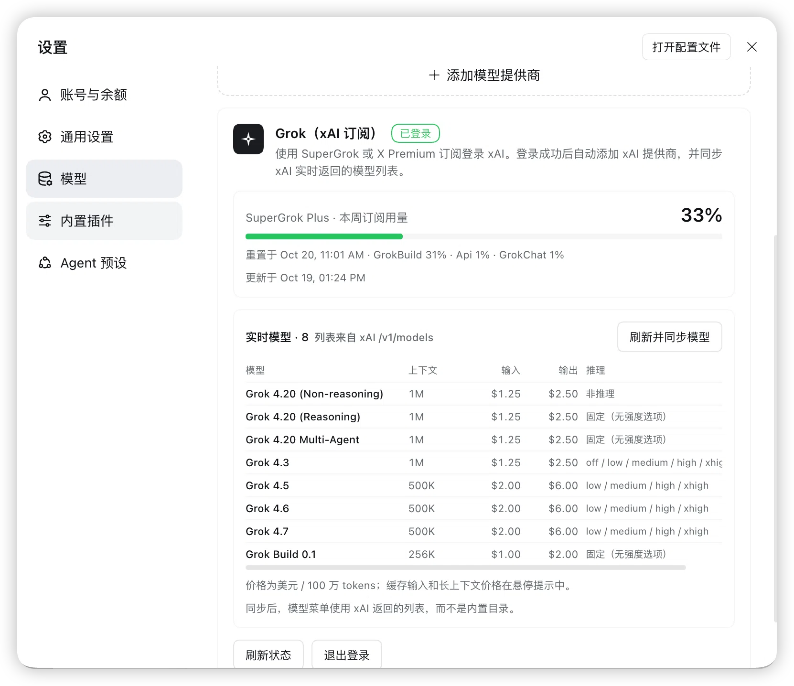

# Grok（xAI 订阅）for DeepSeek Harness

[English](README.en.md) | 简体中文


[](https://github.com/TuDouPn/dsh-grok-xai/actions/workflows/check.yml)

在 [DeepSeek Harness](https://github.com/deepseek-ai/deepseek-harness)（DSH）里使用 **SuperGrok / X Premium 订阅**登录 xAI，直接调用 Grok 模型，并查看订阅用量、实时模型、上下文和价格。

> **非官方项目。** 本项目与 xAI、SpaceXAI、DeepSeek、Anysphere 均无隶属关系。订阅用量接口来自 Grok CLI 的未公开端点，可能随 xAI 更新而变化；请自行评估使用风险，并遵守 xAI 的服务条款。

## 截图



> 截图：套餐、本周订阅用量、实时模型、上下文、价格和推理强度。

---

## 目录

- [截图](#截图)
- [特性](#特性)
- [环境要求](#环境要求)
- [安装](#安装)
- [使用](#使用)
- [套餐、用量、模型和价格](#套餐用量模型和价格)
- [推理强度](#推理强度)
- [工作原理](#工作原理)
- [数据与接口](#数据与接口)
- [安全与隐私](#安全与隐私)
- [已知限制](#已知限制)
- [故障排查](#故障排查)
- [开发](#开发)
- [与 Grok Bot 的关系](#与-grok-bot-的关系)
- [路线图](#路线图)
- [贡献](#贡献)
- [许可证](#许可证)
- [致谢](#致谢)

## 特性

- **订阅登录，不需要 API Key**：通过 xAI 设备码 OAuth 登录，凭证写入 DSH 凭证库的 `llm-pi-ai/xai` 记录。
- **一键接入模型**：登录后自动把 `xai` 提供商写入 `llm-pi-ai`，Grok 模型出现在输入框的模型菜单。
- **订阅用量**：显示套餐（如 SuperGrok Plus）、本周/本月用量百分比、分项、重置时间和预付余额。
- **实时模型列表**：从 `api.x.ai/v1/models` 读取，不再依赖 pi-ai 的内置目录；支持手动刷新并同步。
- **上下文与价格**：模型表显示上下文窗口、输入价格、输出价格；悬停查看缓存输入、长上下文价格和完整模型 ID。
- **推理强度按 xAI 能力校准**：逐个读取 `/v1/models/{id}` 的 `capabilities.reasoning_effort`，不猜测档位；不支持的模型不会出现无效选项。
- **零运行时依赖**：Host 半和 Client 半都是普通 JavaScript，无构建步骤、无第三方 npm 包。

## 环境要求

- DeepSeek Harness，带 Web UI 的 profile（Desktop 或 `dsh web`）。
- DSH 组合中已启用 `llm-pi-ai`、`authorization`、`credentials`、`configEditor`、`webServer` 服务。基础 Web profile 默认具备。
- 有效的 **SuperGrok** 或 **X Premium** 订阅。
- 开发/验证版本：DSH `0.2.1-rc.2`（Desktop）。其他版本如 API 有变化，可能需要适配。

## 安装

### 1. 获取代码

```bash
git clone https://github.com/TuDouPn/dsh-grok-xai.git
cd dsh-grok-xai
```

### 2. 作为本地 bundle 安装到 DSH

DSH 的 bundle 安装会把该目录链接到当前 profile，并写入 `dsh.profile.bundles`。

**方式 A：在 DSH Web 中安装**

1. 打开左侧 **Plugins** 页面。
2. 选择 **Install**（安装 bundle）。
3. 填入克隆目录的**绝对路径**，例如 `/Users/you/code/dsh-grok-xai`。如果界面只接受包名或 URL，改用方式 B。
4. 安装过程中可能需要批准；完成后确认 bundle 已启用。

**方式 B：让 DSH Agent 安装**

在当前 profile 的会话里对 Agent 说：

```text
把 /绝对路径/dsh-grok-xai 作为本地 bundle 安装到当前 profile，并启用它。
```

Agent 会调用 `plugin_manager` 的 `install_bundle`，target 指向该目录。

> 安装会修改当前 DSH profile，影响该 profile 的所有会话。插件以链接方式安装，**不要移动或删除克隆目录**，否则 profile 中的依赖会失效。

### 3. 打开卡片

进入 **设置 → 模型**，滚动到页面底部的 **Grok（xAI 订阅）** 卡片。

### 升级

```bash
git pull
```

然后在 **Plugins** 中重新启用该 bundle，或重启 DSH。Host 代码更新后，仅刷新页面不一定加载新的 Host 模块。

### 卸载

1. 建议先在卡片里点 **退出登录**（删除本地 OAuth 记录）。
2. 在 **Plugins** 中移除该 bundle。
3. 卸载不会自动删除 `llm-pi-ai` 中的 `xai` 提供商配置；如不再使用，可在 **设置 → 模型** 删除该提供商，或从 profile 的 `cordis.patch.yml` 中移除 `providers.xai`。

## 使用

1. 打开 **设置 → 模型**。
2. 在页面底部的 **Grok（xAI 订阅）** 卡片点 **登录 SuperGrok / X Premium**。
3. 打开卡片显示的 xAI 验证链接，输入一次性代码并确认。
4. 回到 DSH。卡片显示「已登录」，并自动同步 xAI 返回的实时模型列表。
5. 在对话输入框的模型菜单中选择 Grok 模型。

### 卡片上的操作

| 操作 | 作用 |
|---|---|
| 登录 SuperGrok / X Premium | 启动一次 xAI 设备码登录 |
| 取消登录 | 取消当前设备码轮询 |
| 刷新 | 重新读取订阅用量和实时模型 |
| 刷新并同步模型 | 读取 `/v1/models` 与每个模型的 `/v1/models/{id}` 能力，写入 `llm-pi-ai` |
| 退出登录 | 删除 DSH 凭证库中的 `llm-pi-ai/xai` 记录，不影响 xAI 账号 |

> 登录后如果模型菜单没有立即刷新，切换一次页面或重启 DSH。模型列表写入 profile 后会在后续会话中保持。

## 套餐、用量、模型和价格

### 套餐和用量

- 套餐名来自 `cli-chat-proxy.grok.com/v1/settings` 的 `subscription_tier_display`，例如 `SuperGrok Plus`。
- 用量来自 `cli-chat-proxy.grok.com/v1/billing?format=credits`，与 Grok CLI 显示的周期用量一致。
- 卡片显示：当前周期百分比、分项（如 GrokBuild / GrokChat）、重置时间、预付余额。
- Host 内缓存 60 秒；显式点「刷新」会强制重新读取。
- 访问令牌临近过期时，插件会在 DSH 凭证存储的写锁内用 refresh token 续期，不需要重新登录。

### 实时模型、上下文和价格

模型表的数据来自：

- `GET https://api.x.ai/v1/models` — 模型 ID、上下文长度、输入/输出/缓存价格、长上下文阈值。
- `GET https://api.x.ai/v1/models/{id}` — `capabilities.reasoning_effort`、默认推理强度等。

价格单位是 **USD / 100 万 tokens**。卡片显示基础输入/输出价格；悬停行可看缓存输入、长上下文价格和完整模型 ID。价格是 xAI 的实时返回值，本文档中的快照可能过期。

当前快照（以卡片实时值为准）：

| 模型 | 上下文 | 输入 | 输出 | 缓存输入 | 长上下文（>200K） |
|---|---:|---:|---:|---:|---:|
| Grok 4.20 Reasoning / Non-reasoning / Multi-Agent | 1M | $1.25 | $2.50 | $0.20 | $2.50 / $5.00 |
| Grok 4.3 | 1M | $1.25 | $2.50 | $0.20 | $2.50 / $5.00 |
| Grok 4.5 | 500K | $2.00 | $6.00 | $0.30 | $4.00 / $12.00 |
| Grok 4.6 | 500K | $2.00 | $6.00 | $0.50 | $4.00 / $12.00 |
| Grok 4.7 | 500K | $2.00 | $6.00 | $0.50 | $4.00 / $12.00 |
| Grok Build 0.1 | 256K | $1.00 | $2.00 | $0.20 | $2.00 / $4.00 |

> xAI 的模型接口不返回“最大输出 tokens”。同步后的配置中，已知模型复用 pi-ai 目录的元数据，未知模型使用路由的保守默认值。

## 推理强度

同步模型时，插件会逐个请求 `/v1/models/{id}`，只使用 xAI 声明的 `capabilities.reasoning_effort`：

| 模型 | 可选推理强度 | 说明 |
|---|---|---|
| Grok 4.3 | `off / low / medium / high / xhigh` | `off` 映射到 API 的 `none` |
| Grok 4.5 / 4.6 / 4.7 | `low / medium / high / xhigh` | 不支持 `none` |
| Grok 4.20 Reasoning | 固定，无强度选项 | API 拒绝 `reasoningEffort` |
| Grok 4.20 Non-reasoning | 非推理 | 无强度选项 |
| Grok 4.20 Multi-Agent | 固定，无强度选项 | xAI 未声明可切换档位 |
| Grok Build 0.1 | 固定，无强度选项 | API 拒绝 `reasoningEffort` |

> “固定”只表示没有可切换档位，不表示关闭推理。Grok 4.20 Reasoning / Multi-Agent 仍会按模型默认方式推理；强行写死 `low/medium/high` 反而可能触发 400。

## 工作原理

```mermaid
flowchart LR
  U[用户] --> UI[DSH Web UI<br/>设置 → 模型]
  UI --> C[client.js<br/>Grok 卡片]
  C -->|同源 JSON<br/>/grok-auth/*| H[index.js<br/>Host 半]
  H -->|ctx.authorization| A[DSH authorization<br/>llm-pi-ai/xai]
  A --> S[(DSH 凭证库)]
  H -->|ctx.configEditor| P[llm-pi-ai 配置<br/>providers.xai]
  H -->|Bearer access token| X[xAI<br/>/v1/models<br/>/v1/models/{id}]
  H -->|Bearer access token| B[Grok CLI proxy<br/>/v1/billing<br/>/v1/settings]
  P --> M[模型菜单]
```

- **Host 半**：`index.js` 注册 `/grok-auth/*` 同源 JSON 路由；启动设备码登录、读取用量和模型、写回 `llm-pi-ai` 配置。
- **Client 半**：`client.js` 注册到 `settings.models.footer`，渲染登录、用量、模型表和同步操作。
- **凭证**：OAuth 记录由 DSH 的 `authorization` / `credentials` 管理；插件只读取 access token 用于 xAI 请求，不返回、不记录。
- **模型**：同步写入 `providers.xai.models`，所以模型菜单使用 xAI 返回的列表，而不是内置目录。

## 数据与接口

| 接口 | 用途 | 说明 |
|---|---|---|
| `GET https://api.x.ai/v1/models` | 实时模型列表 | 过滤出可对话模型 |
| `GET https://api.x.ai/v1/models/{id}` | 模型能力与价格 | `capabilities.reasoning_effort` 用于推理校准 |
| `GET https://cli-chat-proxy.grok.com/v1/billing?format=credits` | 订阅用量 | Grok CLI 使用的未公开端点 |
| `GET https://cli-chat-proxy.grok.com/v1/settings` | 套餐、默认模型、能力开关 | 未公开端点 |
| `x-ratelimit-*` 响应头 | RPM/TPM 限流窗口 | 仅真实推理响应携带，当前未展示 |
| `GET /v1/api-key` | — | 订阅 OAuth 返回 401，不可用 |
| `GET /v1/usage` | — | 返回 404，xAI 无公开 usage 端点 |

本插件**不依赖** Grok Bot 或任何 Anysphere 运行时；它走 DSH 自带的 pi-ai xAI 适配器和 xAI OAuth。

## 安全与隐私

- **令牌不经过插件日志或页面**：OAuth 凭证由 DSH `authorization` / `credentials` 写入 `llm-pi-ai/xai`；插件只把 access token 放进 `Authorization: Bearer` 请求头。
- **同源校验**：`/grok-auth/*` 路由要求请求的 `Origin` 与 `Host` 一致；没有跨站 CORS 接口。
- **无遥测**：插件不收集、不上报任何使用数据。
- **最小权限**：不读取 Grok Bot、Cursor 或其他应用的数据目录；不读取浏览器 Cookie；不访问 keychain。
- **未公开端点**：billing/settings 来自 Grok CLI 的代理端点，xAI 可能随时更改或限制。请只在遵守订阅条款的前提下使用。
- **不要分享凭证**：提交 issue 时不要粘贴 `~/.dsh/.credentials.yaml`、访问令牌、refresh token 或完整请求头。

发现安全问题请按 [SECURITY.md](SECURITY.md) 私下报告，不要开公开 issue。

## 已知限制

- 需要有效的 SuperGrok / X Premium 订阅；登录成功不代表账号一定有模型权限。
- xAI 的 billing/settings 是未公开端点，可能随版本变化；变化时插件会显示错误而不是伪造数据。
- `/v1/models` 不提供最大输出 tokens；配置使用 pi-ai 目录或路由默认值。
- Grok 4.20 Reasoning / Multi-Agent / Build 0.1 没有可切换的推理档位，这是 xAI 的模型能力，不是插件缺陷。
- 模型列表、价格、上下文会随 xAI 更新；以卡片实时值为准。
- 本地 bundle 以链接方式安装；移动/删除源码目录会导致 profile 依赖失效。
- 主要在 DSH Desktop `0.2.1-rc.2` 验证；其他版本的 UI/服务接口可能不同。

## 故障排查

| 现象 | 处理 |
|---|---|
| 模型请求报 `Provider is not configured: xai` | 还没完成订阅登录；在卡片登录，或确认 `llm-pi-ai/xai` 凭证存在 |
| 卡片显示「已登录」但模型不可用 | 确认 **设置 → 模型** 中有 `xAI (Grok)` 提供商；没有就点「添加 xAI 提供商」 |
| 报 `UNSUPPORTED_REASONING_EFFORT` | 点「刷新并同步模型」；或选择该模型支持的档位 |
| 用量显示「订阅凭证已过期」 | 退出登录后重新登录；插件会自动续期，续期失败才需要重登 |
| 模型菜单没有新模型 | 点「刷新并同步模型」；同步会覆盖 `xai` 提供商的模型列表 |
| 验证码过期 | 重新点「登录 SuperGrok / X Premium」获取新代码 |
| 卡片不出现 | 确认 bundle 已启用；刷新页面；必要时重启 DSH |
| 安装时报路径错误 | 使用克隆目录的**绝对路径**；确认 `package.json` 存在且包含 `dsh.bundle.patch` |

## 开发

### 结构

| 文件 | 作用 |
|---|---|
| `index.js` | Host 半：`/grok-auth/*` 路由、OAuth 设备码、用量、模型同步、配置写入 |
| `client.js` | Client 半：`settings.models.footer` 卡片、用量面板、模型表 |
| `cordis.patch.yml` | 安装时插入 `grok-xai` 插件行 |
| `locale/*.json` | 插件标题与描述（中文 / English） |
| `icon.svg` | 插件图标 |
| `docs/grok-bot-capabilities.md` | Grok Bot 能力与可接入面的调研笔记 |
| `README.en.md` | English README |
| `LICENSE` | MIT |

### 本地检查

```bash
node --check index.js
node --check client.js
```

插件没有构建步骤、没有 npm 依赖。修改后，把目录重新安装为本地 bundle，或重启 DSH 让 Host 模块重新加载。Client 半在 Web 页面中通过 HMR 更新；如果没生效，刷新页面。

包名使用 `@local/` 前缀是为了把它当作本地 bundle 安装；如果要发布到 npm，请同时修改 `package.json` 的 `name`、`cordis.patch.yml` 中的 `name`，并重新安装 bundle。

### 调试接口

Host 半注册了以下同源路由。它们只返回状态和统计，不返回令牌：

| 路由 | 方法 | 作用 |
|---|---|---|
| `/grok-auth/state` | GET | 登录/提供商状态、设备码通知 |
| `/grok-auth/sign-in` | POST | 启动设备码登录 |
| `/grok-auth/cancel` | POST | 取消登录 |
| `/grok-auth/sign-out` | POST | 删除本地 OAuth 记录 |
| `/grok-auth/add-provider` | POST | 重试添加 `xai` 提供商 |
| `/grok-auth/observability` | GET | 套餐、用量、实时模型、已解析推理档位 |
| `/grok-auth/sync-models` | POST | 读取实时模型能力并写入配置 |

## 与 Grok Bot 的关系

本项目的**运行时不依赖 Grok Bot**。Grok Bot（`com.anysphere.sand`）是独立的桌面 Agent，没有公开的本地 API/CLI；它和本插件共享的只是 xAI 账号与订阅。

Grok Bot 的 Hooks、Deep Link、MCP 连接器等可接入面，以及可移植能力清单，见 [docs/grok-bot-capabilities.md](docs/grok-bot-capabilities.md)。这部分目前是调研和路线图，不在本插件的运行时内。

## 路线图

- [x] SuperGrok / X Premium 设备码登录
- [x] 订阅用量、套餐、重置时间
- [x] 实时模型列表、上下文、价格
- [x] 按 xAI 能力校准推理强度
- [ ] RPM/TPM 限流窗口展示（可选的一次 1-token 探测）
- [ ] 图像 / 视频 / 语音生成工具
- [ ] Grok Bot Hook Bridge（审计、审批、上下文注入）
- [ ] Google Workspace / Slack / Notion 等 MCP 连接器预设
- [ ] 自动化测试与 CI

## 贡献

欢迎 issue 和 PR。请先阅读 [CONTRIBUTING.md](CONTRIBUTING.md)。

- 不要在 issue/PR 中粘贴访问令牌、refresh token、`~/.dsh/.credentials.yaml` 或其他个人数据。
- 保持零运行时依赖；Host/Client 使用普通 ESM/JavaScript。
- 修改行为时同步更新 README、`README.en.md` 和 `CHANGELOG.md`。
- 提交前运行 `node --check index.js` 和 `node --check client.js`。

## 许可证

[MIT](LICENSE) © 2026 dsh-grok-xai contributors

## 致谢

- [DeepSeek Harness](https://github.com/deepseek-ai/deepseek-harness) 的插件、授权和 pi-ai 适配器
- [pi-supergrok-usage](https://github.com/MatheusBBarni/pi-supergrok-usage) 与 [openusage](https://github.com/openusage-community/openusage) 对 Grok 账单端点的公开整理
- [xAI Models REST API](https://docs.x.ai/developers/rest-api-reference/inference/models) 与 [xAI Reasoning 文档](https://docs.x.ai/developers/model-capabilities/text/reasoning)
